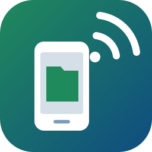

# Mobile Device Manager

[](https://boosty.to/rtm00)

Mobile Device Manager connects Android and iOS devices to VS Code over Wi-Fi and turns their storage into a normal folder: browse it, open and edit device files in the editor, and copy files both ways with drag and drop.

**Nothing to install.** iOS support talks to the usbmuxd service that ships with macOS directly (no libimobiledevice, no Python). For Android, if `adb` is not installed yet, one click downloads Google's Platform-Tools into the extension's storage.



> **Preview.** See [docs/ROADMAP.md](docs/ROADMAP.md) for what comes next.

## Android: connect over Wi-Fi

Open **Devices** in the Activity Bar and press **Connect over Wi-Fi** (the antenna button):

- **Found on the network** — devices with Wireless debugging turned on that adb discovered through mDNS. One click connects.
- **Recent** — addresses you connected to before.
- **Enter IP Address and Port…** — the address shown under Developer options → Wireless debugging.
- **Pair with Pairing Code…** — the first connection on Android 11 and newer: on the device choose *Pair device with pairing code*, pick it in the list (or type the address) and enter the six-digit code. Once paired, the device connects by itself.
- **Switch USB Device to Wi-Fi…** — for any Android version: plug the device in once, the extension runs `adb tcpip 5555`, finds the Wi-Fi address and connects. The cable can be unplugged afterwards.

Each device shows how it is connected (Wi-Fi, USB, emulator) and why it is not usable (*allow USB debugging on the device*, *offline*). **Disconnect** drops a Wi-Fi connection.

## iPhone and iPad over Wi-Fi

1. Connect the device with a USB cable, unlock it and tap **Trust** (on macOS open Finder if the dialog does not appear).
2. Right-click the device in **Devices** → **Enable Wi-Fi Connection** (the same switch as *Show this iPhone when on Wi-Fi* in Finder).
3. Unplug the cable. While the device is awake and on the same network, it stays in the list marked *Wi-Fi*.

Under the device:

- **Media** — the shared media area: `DCIM` (photos and videos), `Downloads`, `Books` and the rest of what Finder and Image Capture see.
- **Apps** — the *Documents* folder of every app that shares files with the computer (the apps listed in Finder → Files): note-taking apps, VLC, Documents, your own apps with `UIFileSharingEnabled`.

iOS does not expose anything else: no system files and no data of apps that do not share files. Locked devices show *unlock the device*.

macOS has everything built in. Windows needs the [Apple Devices](https://apps.microsoft.com/detail/9np83lwlpz9k) app (or iTunes) for its USB driver; Linux needs `usbmuxd` (`sudo apt install usbmuxd`).

## Files

Expand an Android device to browse its shared storage (`/sdcard`, change it with `mobile-device-manager.android.rootPath`), or an iOS device to browse Media and Apps.

- Click a file to open it in the editor; saving writes it back to the device.
- **Open in Explorer** adds the device (or a folder of it) to the workspace as `android://…` or `ios://…`. The Explorer, Quick Open, search, copy/paste and drag and drop between local and device folders then work as with any folder.
- **Upload…** / **Download…** take whole folders and many files at once (`adb push` / `adb pull` on Android).
- Drag files from the Explorer or from Finder / File Explorer onto a device folder to upload them. Drag items inside the Devices view to move them on the device, or onto another device to copy them.
- **New Folder…**, **Rename…**, **Delete…**, **Copy Path**, **Open Device Shell** (Android: an `adb shell` terminal in that folder).

## Requirements

- **Android:** `adb` from Android SDK Platform-Tools. The extension looks in `$ANDROID_HOME`, the default Android SDK location and Homebrew; if there is none, **Download Android Platform-Tools** fetches it from Google. On the device: Developer options with Wireless debugging (Android 11+) or USB debugging.
- **iOS:** usbmuxd — built into macOS, the Apple Devices app on Windows, the `usbmuxd` package on Linux.
- The device and this computer on the same network.

## Settings

| Setting | Default | |
|---|---|---|
| `mobile-device-manager.adbPath` | *(auto)* | Path to `adb`. |
| `mobile-device-manager.android.rootPath` | `/sdcard` | Folder shown under each Android device. |

## Development

```bash
npm install
npm run check   # type-check
npm test        # unit tests
npm run build   # bundle into dist/
```

Press **F5** (*Run Extension (No Debugger)*) to start an Extension Development Host.

## Support

If Mobile Device Manager saves you time, you can support its development on [Boosty](https://boosty.to/rtm00).

*Android is a trademark of Google LLC. iOS is a trademark of Cisco, used by Apple under license. Mobile Device Manager is not affiliated with or endorsed by Google or Apple.*
